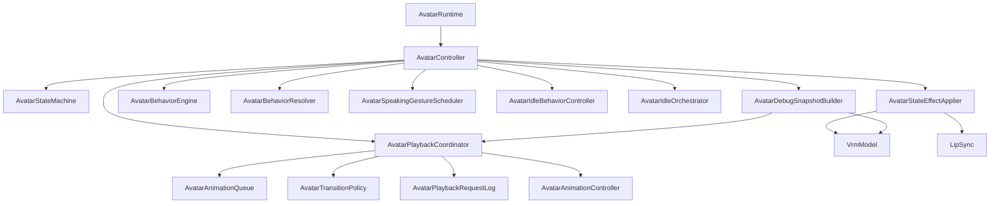

# AvatarController Responsibility Audit

Date: 2026-07-08

## Scope

This audit covers the renderer Avatar Runtime internals. Runtime boundaries from `ARCHITECTURE.md` remain unchanged: `AvatarRuntime` owns physical embodiment, observes `CharacterState`, and exposes the same public controller surface to the rest of the renderer.

## Responsibility Map

| Area | Before | After |
|---|---|---|
| Character State application | `AvatarController.applyStateEffect()` directly changed procedural mode, look-at, head motion, emotion, mouth reset, and LipSync | `AvatarStateEffectApplier` applies visual/LipSync effects; controller decides when to apply them |
| Runtime mode orchestration | `AvatarController` + `AvatarStateMachine` | unchanged; `AvatarStateMachine` remains source for mode effects |
| Animation selection | `AvatarBehaviorResolver`, `AvatarBehaviorEngine`, partial debug-only gesture selection | `AvatarBehaviorResolver` and `AvatarSpeakingGestureScheduler`; old gesture scheduler is now only a debug semantic tracker |
| Playback pipeline | `AvatarController` owned queue, transition policy, playback request log, current playback context, behavior timeline | `AvatarPlaybackCoordinator` owns queue/policy/log/context/timeline and centralizes play requests |
| Debug snapshot | `AvatarController.getDebugState()` manually assembled all fields | `AvatarDebugSnapshotBuilder` assembles the snapshot |
| Utility mapping | private controller methods | `AvatarRuntimeMappers` |
| Runtime update loop | `AvatarController.update()` | unchanged orchestration entry point |

## Dependency Diagram

## Notes

- `CharacterState` remains the source of truth for the current condition.
- Queue semantics, transition policy semantics, speaking scheduler semantics, animation runtime semantics, and speech runtime semantics were preserved.
- `AvatarController` remains the composition/orchestration point, but no longer implements debug aggregation, mapping, state-effect application, or playback pipeline details directly.
